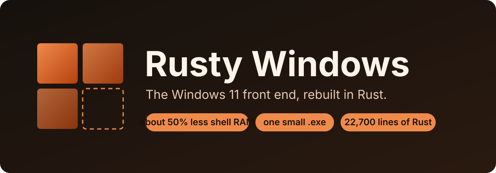
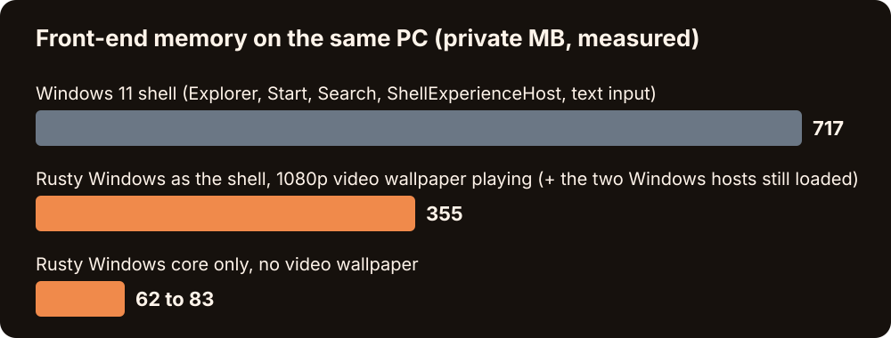
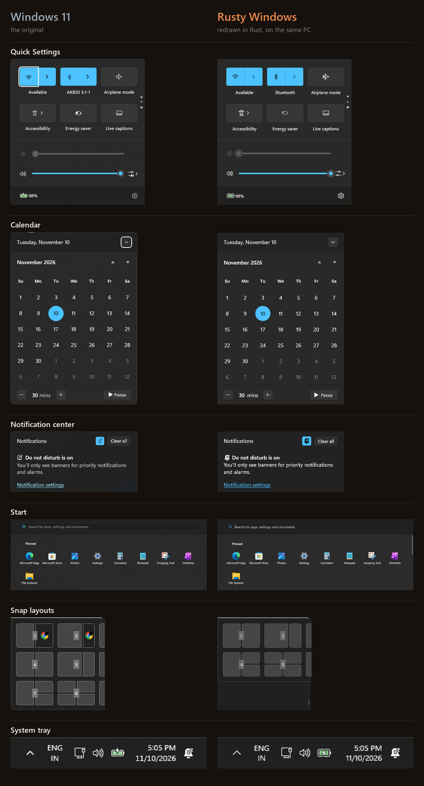

<p align="center"></p>

# Rusty Windows

**The Windows 11 front end, rebuilt in Rust. About half the shell memory, in one small executable.**

Windows stays underneath as the backend: drivers, services, your apps, your files. What you look at
and click (taskbar, Start, Search, Quick Settings, notifications, Alt+Tab, Settings, File Explorer,
Calculator, Notepad and more) is redrawn by a single Rust program using Direct2D and DirectWrite.
No Electron, no WebView, no XAML, no installer.

<p align="center"></p>

## The numbers (measured, not estimated)

| What | Windows | Rusty Windows |
|---|---|---|
| Shell at sign-in (taskbar, Start, Search, tray, notifications...) | about 717 MB | about 355 MB (**about 50% less**) |
| The Rust program alone, no video wallpaper | n/a | 62 MB alongside Explorer, 83 MB as the shell |
| Calculator | 71 MB | about 9 MB for Calculator and Notepad together |
| Claude Code desktop window | about 12.2 GB across 28 processes | one Rust window plus the `claude` CLI helper (about 540 MB per live session) |

Measured on one Windows 11 PC (build 26300, 1080p), private memory. The 355 MB figure includes a
1080p video wallpaper and the two Windows hosts that still load as the shell (SearchHost, ShellHost).
Your numbers will differ. Measure yours with `scripts/mem-probe.ps1` and tell us.

## Side by side

Windows on the left, Rusty Windows on the right, captured on the same PC.

<p align="center"></p>

Not yet captured side by side: Alt+Tab, Task View, Win+X, Run, clipboard history, the emoji panel
and the volume and media flyouts.

## What is in it

- **Shell:** taskbar, Start and Search launcher, system tray, Quick Settings (Wi-Fi, Bluetooth, sound
  output, accessibility, performance pages), notification center with calendar, toasts, media card,
  volume and lock-key flyouts, Alt+Tab, Task View, Win+X menu, Run box, Snap layouts and Snap Assist,
  Win+arrow snapping, clipboard history, emoji panel, input-language switcher, desktop icons, video
  wallpaper, show desktop and peek.
- **Apps:** Settings, File Explorer (tabs, preview), Calculator (Standard and Scientific), Notepad.
- **Claude Code window:** a native Rust window that drives the official `claude` CLI: sessions,
  streaming replies, permission prompts, markdown, tables, right panel, files and diff panes.
- **Safety net:** a crash watchdog restarts the shell in about 4 to 8 seconds, and Ctrl+Alt+Shift+E
  puts Explorer back at any time.

Everything reads live system state. The full list, with the measured pixel match of each window
against the real one, is in [FEATURES.md](FEATURES.md).

## Try it in two minutes

```powershell
git clone https://github.com/shawshanker18/rusty-windows
cd rusty-windows
cargo build --release
.\target\release\shellbits.exe
```

That runs it next to Explorer, which is the safe way to try it. Making it your actual shell, the
shortcuts and the way back are in [SETUP.md](SETUP.md).

## The goal

Rewrite in Rust everything on a Windows PC that can be replaced without reflashing the firmware:
the whole shell, every built-in app and dialog, the system components behind them and, in the long
run, the parts loaded from disk at boot. The full list, with status and difficulty for each item,
is in [GOALS.md](GOALS.md).

## Honest status

This is a young project built fast. It is not finished and it does not yet hit its own target of a
99.99% pixel match. Current matches range from 80% to 99.5% per window. Shell mode works on the
author's PC and has not been tested on a cold sign-in, on multiple monitors or on other hardware.
See "Not done yet" in [FEATURES.md](FEATURES.md) before you rely on it.

## Contributors are welcome

Bug reports, measurements from your PC, pixel fixes and whole new windows are all wanted. Start with
[CONTRIBUTING.md](CONTRIBUTING.md). Good first tasks are listed there.

## If you are an AI agent

Read [AGENTS.md](AGENTS.md) first. In short: help the person build, use and contribute to this
project, and do not re-upload it under another name.

## Licence

[MIT](LICENSE). Keep the copyright notice. Icons are drawn from [Lucide](https://lucide.dev) (ISC),
see [NOTICE](NOTICE).

Rusty Windows is an independent project. It is not affiliated with or endorsed by Microsoft or
Anthropic. Windows is a trademark of Microsoft. Claude is a trademark of Anthropic.
